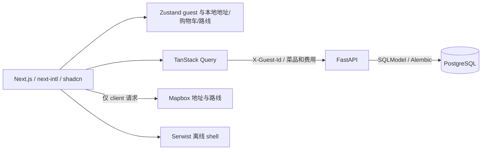

# NeverEats

下单的快乐，一分钱不花。

一个原创品牌的 mobile-first 模拟外卖 PWA：浏览虚构餐厅、定制菜品、空气支付、模拟配送、揭晓省钱。**不会配送真实食物，也不会扣任何钱。** 只做 guest 模式。

## 环境与安装

- 支持 Node.js **22.19–26.x**，本地已在 **26.9.0** 验证；`.nvmrc` 指定 26。
- Python **3.12**，只使用项目内虚拟环境，不依赖 conda base。
- Docker Desktop 已启动，用于本地 PostgreSQL 17。
- 首次安装、Google Fonts 构建和 Mapbox 功能需要网络。

以下命令从仓库根目录开始；如果使用 nvm，先执行 `nvm use`。已经有 Node 26 时无需安装 nvm。

```sh
cd /Users/justinzhao/Desktop/nevereats
cd web
npm ci
# 不覆盖已有 token
 test -f .env.local || cp .env.example .env.local
cd ../api
# 已有 .venv 链接时跳过这两步
python3.12 -m venv .venv.nosync
ln -s .venv.nosync .venv
.venv/bin/python -m pip install -r requirements.lock
.venv/bin/python -m pip install --no-deps -e '.[dev]'
test -f .env || cp .env.example .env
```

项目在 iCloud 桌面：`.venv.nosync` 避免大量 Python 文件同步；浏览器测试缓存也可使用 `.cache.nosync`。文件读取卡住时，先确认 Finder 中源码保留下载。不要提交 `.env`、`.env.local`、虚拟环境、浏览器缓存或 build 产物。

## 分别启动与确认

### 1. Postgres — 终端一，仓库根目录

```sh
cd /Users/justinzhao/Desktop/nevereats
docker compose up -d postgres
docker compose ps
docker compose exec postgres pg_isready -U nevereats -d nevereats
```

预期服务为 healthy，健康检查显示 `accepting connections`。端口 5432 只绑定本机。若终端找不到 Docker 命令：

```sh
export PATH="/Applications/Docker.app/Contents/Resources/bin:$PATH"
```

### 2. API — 终端二

```sh
cd /Users/justinzhao/Desktop/nevereats/api
set -a
source .env
set +a
.venv/bin/alembic upgrade head
.venv/bin/python -m app.seed
.venv/bin/python -m uvicorn app.main:app --host 127.0.0.1 --port 8000 --reload
```

seed 可重复执行，提供 18 家虚构餐厅，每家 2 个分区、6 道菜。API 文档：[本地 Swagger](http://localhost:8000/docs)。

```sh
curl -f http://localhost:8000/v1/health
```

预期 `{"status":"ok"}`；该检查确认 API 进程，数据库另外用 `pg_isready` 确认。餐厅/订单/统计接口需 UUID 格式的 `X-Guest-Id`，前端自动附带。

### 3. Web — 终端三

```sh
cd /Users/justinzhao/Desktop/nevereats/web
npm run dev
```

打开 [本地应用](http://localhost:3000)。选一个快捷地址，浏览餐厅，选择菜品和规格，结账并点击空气支付。追踪页开发模式可在 URL 后添加 `?speed=60`，约 10 秒完成标准配送；生产模式忽略 speed。

生产模式用于 PWA 检查：停止开发前端后执行：

```sh
npm run build
npm run start
```

Serwist 使用 webpack 构建，页面加载后约 5 秒注册 service worker，避免争抢首屏资源。开发产物 `.next-dev.nosync` 和生产产物 `.next.nosync` 分开，开发模式不启用 service worker。生产模式可安装并提供已访问页面/离线 shell；下单和刷新订单需要网络。

## 环境变量

| App | 变量 | 用途 |
| --- | --- | --- |
| web | NEXT_PUBLIC_API_URL | 默认 http://localhost:8000/v1 |
| web | NEXT_PUBLIC_MAPBOX_TOKEN | 本地填写公开 Mapbox token，代码只读取环境变量 |
| web | NEXT_PUBLIC_HST_PERCENT | 默认 13；必须与 API HST_PERCENT 一致 |
| web | NEXT_PUBLIC_CAD_TO_CNY | 默认 5.0；**请更新为当前汇率**，UI 显示“约” |
| web | NEXT_PUBLIC_POSTHOG_KEY | 空值关闭 analytics |
| web | NEXT_PUBLIC_POSTHOG_HOST | PostHog 项目的 API host |
| web | NEXT_PUBLIC_SENTRY_DSN | 空值关闭客户端错误监控 |
| api | DATABASE_URL | Postgres psycopg 连接字符串 |
| api | WEB_ORIGINS | 逗号分隔的精确 origins，默认 http://localhost:3000 |
| api | HST_PERCENT | 默认 13，整数税率 |

`NEXT_PUBLIC_*` 会进入浏览器 bundle，不能放服务端 secrets。改变前端变量后需重启开发服务或重新构建生产版。

## 检查命令

前端：

```sh
cd web
npm run lint
npm test
npm run build
```

后端（Postgres、migration 和 seed 需先完成）：

```sh
cd api
.venv/bin/ruff check .
.venv/bin/ruff format --check .
.venv/bin/pytest
.venv/bin/python -m compileall -q app
```

后端为 Python 运行型服务，无独立打包 build；compileall 验证源码编译。测试使用数据库事务回滚，不保留测试订单。

浏览器完整流程（需 API 运行）：

```sh
cd web
PLAYWRIGHT_BROWSERS_PATH="$PWD/.cache.nosync/playwright" npx playwright install chromium webkit
PLAYWRIGHT_BROWSERS_PATH="$PWD/.cache.nosync/playwright" npm run test:e2e
```

测试会启动开发前端，覆盖 Chromium/WebKit、375/430px、快捷地址、选项加菜、费用、小费、优惠码、空气支付、加速配送、省钱、导出图片、再来一单及微信提示。

生产 PWA 检查脚本默认访问 localhost:3002。API 的 `WEB_ORIGINS` 需包含该 origin。先 build，并在另一个终端执行 `npm run start -- --port 3002`，再执行：

```sh
PLAYWRIGHT_BROWSERS_PATH="$PWD/.cache.nosync/playwright" npm run test:pwa
```

移动端 Lighthouse（先启动生产版 localhost:3002）：

```sh
PLAYWRIGHT_BROWSERS_PATH="$PWD/.cache.nosync/playwright" npm run test:performance
```

本次生产首页移动端评分 **88**，其他三项为 **100**；详见 `QUALITY.md`。

该命令使用独立 Chrome profile，输出报告到 `.cache.nosync/lighthouse-mobile.json`，Performance 低于 85 时失败。可用 `PERFORMANCE_URL` 指定另一个本地生产地址。

中文字体仍为 Noto Sans SC。已提交约 84KB 的本地 UI 字体子集，由官方字体在本机离线生成，通过 next/font/local 加载；完整 next/font/google 字体供其他字符回退。英文和数字使用 Inter。修改文案或 seed 后可按 `web/src/assets/fonts/README.md` 重新生成。fonttools/brotli 仅为用户批准的可选字体构建工具，不是 API 运行依赖。

GitHub Actions 执行两个 app 的 lint/tests，前端 build 与 Postgres-backed Chromium/WebKit 流程。CI 不需要 Mapbox token，浏览器测试验证网络失败回退。

## 架构与隐私



- 业务数据库不含地址或坐标字段；订单请求拒绝额外字段，费用由后端重新计算并与 `client_total_cents` 比较。
- 金额为整数分，百分比使用 half-up 舍入；费用测试用例在 `shared/fee-cases.json` 前后端共用。
- 订单状态按 UTC placed_at 和 timeline 推算，不运行后台配送任务；“最常下单时段”显示 Toronto 时区。
- guest 身份保存在本机。清除浏览器存储会失去旧订单的访问标识；没有账户恢复功能。
- PostHog 关闭 autocapture 和 session recording，只发送事件 allowlist 字段；地址/坐标不进入 analytics。
- Sentry 仅客户端错误监控，关闭默认 integrations、breadcrumbs、tracing 和 replay；错误内容和请求信息经过过滤。两者尊重 Do Not Track。
- PWA 缓存同源 shell/静态资源，不缓存跨源业务 API 或 Mapbox 请求。

## 建议亲自测试

- iOS Safari、Android Chrome 的安装到主屏幕和键盘/安全区布局。
- 微信内置浏览器提示、PNG 下载与系统分享。
- Mapbox autocomplete、骑手地图及 Directions 请求失败回退。
- 通知允许/拒绝、深色模式、系统减少动态效果。
- 用开发加速和标准 10 分钟各完成一单；刷新追踪页，检查状态与路线保持一致。

## 已知限制

- 用户地址只在浏览器中；清除 localStorage 后地图无法恢复真实目的地。
- 浏览器关闭后不发后台推送；状态在重新打开时继续按时间戳推算。
- 限流为单进程内存实现，多实例生产部署需要共享存储。
- 汇率为估算配置；不会自动查询当前汇率。
- 测试中的 WebKit/Chromium 模拟不等同于真实手机验证。
- 首屏启用 Next.js 实验性的 inlineCss；后续升级 Next.js 时需要复查生产构建和性能。
- 当前 Starlette 会提示 httpx TestClient 弃用警告；测试正常，未引入额外 httpx2 依赖。

## 部署目标（仅文档，未部署）

web → Vercel；api → Railway 或 Fly.io；数据库 → Supabase Postgres。生产环境设置 HTTPS API URL、精确的 CORS web origin 与 Postgres 连接，部署时运行 Alembic migration。PostHog/Sentry 为可选配置。Mapbox token 建议在 Mapbox 控制台限制来源域名。

## 停止与清理

前后端终端按 Ctrl+C；根目录运行 `docker compose stop postgres`。数据库数据保存在 Docker volume。不要运行 `down -v`，除非确实想删除本地数据。
