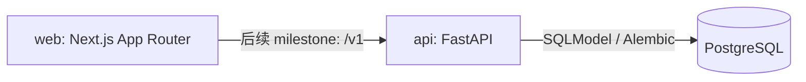

# NeverEats

下单的快乐，一分钱不花。

当前为 Milestone 1：前后端开发骨架。餐厅、购物车、模拟支付、追踪和 PWA 等功能将在后续 milestone 实现。

## 环境

- Node.js 22–26；`.nvmrc` 使用 26，与本机 Node 26 对齐。实际兼容性须以安装、lint、tests 和 build 检查为准。
- Python 3.12，使用 `api/.venv`（指向 `.venv.nosync`），不要使用 conda base。已有该环境时跳过创建和 symlink 步骤。
- Docker Desktop（启动 PostgreSQL）。

## 安装

在仓库根目录执行：

```sh
nvm use
cd web
npm install
cp .env.example .env.local
cd ../api
python3.12 -m venv .venv.nosync
ln -s .venv.nosync .venv
.venv/bin/python -m pip install -e '.[dev]'
cp .env.example .env
cd ..
```

若已有 `.env.local` 或 `.env`，跳过对应复制步骤。不要提交环境文件。`.env.example` 仅包含本地开发示例。

## 分别启动与检查

### 1. PostgreSQL（仓库根目录）

```sh
docker compose up -d postgres
docker compose ps
docker compose exec postgres pg_isready -U nevereats -d nevereats
```

服务应显示 healthy；`pg_isready` 应显示 accepting connections。本地端口为 5432，仅绑定 loopback。Docker volume 保留数据库数据。

### 2. 后端（新终端）

```sh
cd api
set -a
source .env
set +a
.venv/bin/alembic upgrade head
.venv/bin/fastapi dev app/main.py --host 127.0.0.1 --port 8000
```

访问 http://localhost:8000/docs 查看 API 文档；执行：

```sh
curl -f http://localhost:8000/v1/health
```

应返回 `{"status":"ok"}`。此 endpoint 检查 API 进程，不检查数据库；数据库用上面的 `pg_isready` 单独确认。Milestone 1 只配置 Alembic，尚无业务表和 migration。

### 3. 前端（新终端）

```sh
cd web
npm run dev
```

打开 http://localhost:3000。应看到橙色 NeverEats 品牌和四个底部导航入口，点击可切换占位页。用浏览器设备模式检查 375px 和 430px 宽度，桌面内容居中且最大宽度 430px。

`next/font` 在首次构建时需联网下载 Google Fonts。

## 环境变量

| App | 变量 | 用途 |
| --- | --- | --- |
| web | NEXT_PUBLIC_API_URL | 后续 API 调用的基地址；骨架尚未请求 API |
| api | DATABASE_URL | SQLAlchemy Postgres 连接字符串，psycopg 驱动 |
| api | WEB_ORIGINS | 逗号分隔的 CORS origins，默认 http://localhost:3000 |

## 检查命令

```sh
cd web
npm run lint
npm test
npm run build
```

```sh
cd api
.venv/bin/ruff check .
.venv/bin/ruff format --check .
.venv/bin/pytest
```

GitHub Actions 对两个 app 执行 lint 和 tests，另检查前端生产构建。

## 架构



地址和坐标未来仅保存在浏览器中。金额使用整数分。UI 文案统一放在 `web/src/messages/zh-CN.json`，通过 next-intl 读取。原创品牌主题定义在 `web/src/app/globals.css`。

## 部署目标（仅文档）

web 部署到 Vercel，api 部署到 Railway 或 Fly.io，数据库使用 Supabase Postgres。配置 HTTPS API URL、精确的 web CORS origin 和生产数据库连接；部署时运行 Alembic migration。未进行实际部署。

## 停止服务

前后端终端按 Ctrl+C；仓库根目录运行 `docker compose stop postgres`。不要使用 `down -v`，除非确实想删除本地数据库数据。
